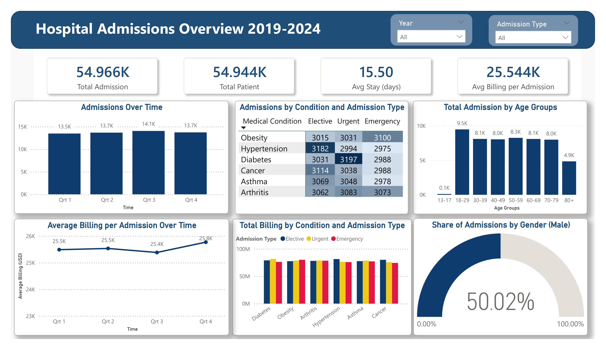

# Healthcare Admissions Analytics in the US (2019–2024)

## 🗄️ Data Source

- Kaggle: 'Healthcare Dataset' by Prasad Patil (synthetic data)
- Link: https://www.kaggle.com/datasets/prasad22/healthcare-dataset/data
- License: CC0: Public Domain

## 🛠️ Tools

- Power BI, SSIS (data cleaning, star-schema data warehouse), SSAS (OLAP model)

## 📌 Key Insights

- **Patient Demographics**
  - The proportion of male and female patient admissions is nearly equal (around 50% for both genders).
  - Although these are chronic conditions, many young people (aged 18-29) were admitted, making this the highest age group with about 9,500 admissions, roughly 1,200 higher than the next-highest group.
- **Admission Patterns**
  - Quarter 3 (July to September) has the highest admissions at 14.1K (all years combined), only about 4% above the lowest quarter, while the other quarters are nearly equal (13.5K to 13.7K).
  - Obesity has the most emergency admissions (3.1K), though not much higher than other conditions. For urgent and elective types, Diabetes (3,197) and Hypertension (3,182) are the highest respectively.
- **Financial Patterns**
  - The average billing per admission in Quarter 3 is the lowest at 25.4K, but only about 1.5% below the highest quarter (Q4, 25.8K).
  - Total billing is nearly the same across conditions and admission types (about 75M to 82M for each combination).

## 📊 Dashboard using Power BI

